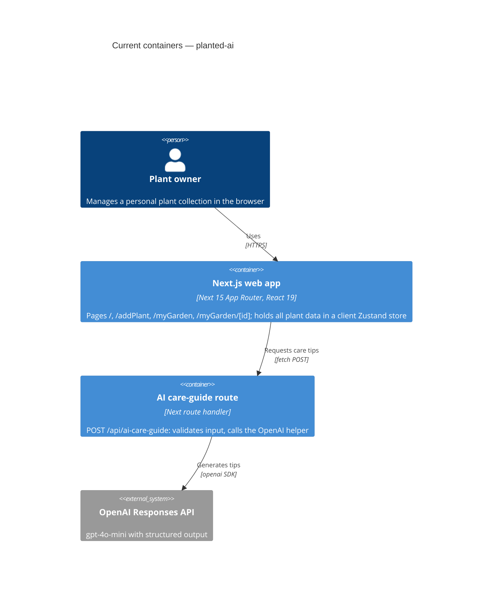

# Architecture map — planted-ai

> The **current** architecture (what exists today), produced by `survey` and read by
> specify / design / data-model / implement. Refresh with `survey` when the repo drifts past
> `reflects_commit`. This is generated; a hand-maintained `docs/architecture.md`, if present, is
> authoritative and reconciled below — not replaced.

## Stack

- Language / runtime: TypeScript ^5, strict (`tsconfig.json`); React ^19.0.0; Next 15.3.3, App Router (`package.json`, `pnpm-lock.yaml`)
- Frameworks / libs: Zustand ^5.0.5, Zod ^3.25.56, react-hook-form ^7.57 + `@hookform/resolvers`, `openai` ^6.7.0, Tailwind ^4 (CSS-first), shadcn/ui on Radix, `uuid` ^11, `lucide-react`
- Package manager: pnpm (`pnpm-lock.yaml` is the only lockfile)
- Build / test / lint (scripts in `package.json`): `pnpm build`, `pnpm test` (Vitest `vitest run`), `pnpm lint` (`next lint`), `pnpm typecheck` (`tsc --noEmit`), `pnpm dev` (`next dev --turbopack`). Scripts were read, not run, during this survey.

## C4 — system as it is

There is no database, no auth and no separate backend service. Plant data lives only in the browser store and resets to mock data on refresh.

## Module inventory

| Module | Path | Layers | Wired at | Responsibility |
|---|---|---|---|---|
| Pages | `app/` | UI (all pages are client components) | `app/layout.tsx` | Landing, add-plant form, plant table, plant detail |
| AI route | `app/api/ai-care-guide/route.ts` | HTTP handler | `app/api/ai-care-guide/route.ts:5` | Zod-validate body, call helper, map to 400/502/500 |
| AI helper | `lib/aiHelpers.ts` | server-only integration | `lib/aiHelpers.ts:23` | OpenAI Responses API with structured output |
| Store | `lib/store/plantsStore.ts` | client state + fetch | `lib/store/plantsStore.ts:26` | Plants, add/update/remove, AI generation status |
| Schemas | `schemas/plantFormSchema.ts`, `schemas/careTipsSchema.ts` | validation | `lib/store/plantsStore.ts:81` | Form contract; care-tips contract shared by client and server |
| Types | `types/plant.ts`, `types/store.ts` | types | `lib/store/plantsStore.ts` | `TPlant`, `TPlantState` |
| Mock data | `lib/mockdata.ts` | seed data | `lib/store/plantsStore.ts` | Initial plants (to be removed by the backend work) |
| Helpers | `lib/plantTotals.ts`, `lib/constants.ts`, `lib/utils.ts` | utilities | `app/myGarden/page.tsx` | Price/amount totals, plant types/dest lists, `cn()` |
| UI kit | `components/ui/` | shadcn primitives | pages | button, card, dialog, form, input, label, navigation-menu, select, sheet, table |
| App chrome | `components/header.tsx`, `components/headerMenu.tsx` | UI | `app/layout.tsx` | Header and navigation menu |

## Conventions (cited — the rules a new feature must match)

- **Module wiring / registration:** App Router file conventions; pages import the store directly — `app/myGarden/[id]/page.tsx`
- **Error handling:** route returns JSON `{ error }` with 400 (bad body), 502 (AI incomplete), 500 (throw) — `app/api/ai-care-guide/route.ts:16`, `:32`, `:40`; the store records `aiStatus: "error"` + `aiError` — `lib/store/plantsStore.ts`
- **IDs:** `uuid` v4, generated in the store (client side) — `lib/store/plantsStore.ts:92`; mock data uses string ids like `"01"` — `lib/mockdata.ts`
- **Validation:** Zod at every boundary — form via `zodResolver(PlantFormSchema)` (`app/addPlant/page.tsx`), AI output via `CareTipsSchema.safeParse` (`lib/store/plantsStore.ts:81`), request body via an inline schema (`app/api/ai-care-guide/route.ts:5`)
- **Persistence / DB access:** none — client Zustand store wrapped in `devtools` only, no `persist` — `lib/store/plantsStore.ts:26`
- **Migrations:** none (no database, no migration tool)
- **Tests:** Vitest, `*.test.ts` next to the tested file, node environment, `@` alias — `vitest.config.mts`; examples `lib/store/plantsStore.test.ts`, `lib/aiHelpers.test.ts`, `app/api/ai-care-guide/route.test.ts`. No component/UI tests.
- **Inter-module communication:** store → `fetch("/api/ai-care-guide")` → helper → OpenAI — `lib/store/plantsStore.ts:51`
- **Secrets:** `OPENAI_API_KEY` read server-side only — `lib/aiHelpers.ts:5`; `.env*` is git-ignored — `.gitignore:35`; no `.env.example`
- **UI / styling:** shadcn/ui (`new-york`) + Tailwind 4 — `components.json`, `app/globals.css` (detail in §Frontend / UI foundation)

## Datastores

| Store | Engine | Accessed via | Notes |
|---|---|---|---|
| Plants | Zustand (in-memory, browser) | `usePlantStore` — `lib/store/plantsStore.ts` | Not persisted; resets to `lib/mockdata.ts` on refresh. No server-side storage. |

## Frontend / UI foundation

- **Component library / design system:** shadcn/ui, style `new-york`, base color `stone`, CSS variables, lucide icons — `components.json`
- **Design tokens:** CSS variables mapped in `@theme inline`, light and `.dark` palettes — `app/globals.css`; Geist / Geist Mono fonts via `next/font` — `app/layout.tsx`
- **Styling approach:** Tailwind 4 utility classes (CSS-first config), `cn()` helper — `app/globals.css`, `lib/utils.ts`
- **Shared primitives:** `components/ui/{button,card,dialog,form,input,label,navigation-menu,select,sheet,table}.tsx`
- **State / data-fetching:** Zustand store; no server-cache library — `lib/store/plantsStore.ts`
- **Closest UI precedent:** a form screen looks like `app/addPlant/page.tsx` (shadcn Form + Input + Button, react-hook-form + Zod); a detail screen looks like `app/myGarden/[id]/page.tsx` (Card + sections + lucide icons); a table screen looks like `app/myGarden/page.tsx`.
- **Routes:** `/` (landing), `/addPlant`, `/myGarden`, `/myGarden/[id]`, `/api/ai-care-guide`. `app/search/` and `app/takePhoto/` are empty directories with no `page.tsx`.

## Where things live / closest precedents

- A new page → `app/<route>/page.tsx`, modelled on `app/myGarden/page.tsx` (table) or `app/addPlant/page.tsx` (form).
- A new server endpoint → `app/api/<name>/route.ts`, modelled on `app/api/ai-care-guide/route.ts`, with reusable logic in `lib/` like `lib/aiHelpers.ts`.
- A new Zod contract shared by client and server → `schemas/`, modelled on `schemas/careTipsSchema.ts` (no server-only imports).
- A new UI component → composed from `components/ui/`, modelled on `app/myGarden/[id]/page.tsx`.

## Constraints & known tech-debt

- **AI route is unauthenticated and unthrottled** — `app/api/ai-care-guide/route.ts:5-10` accepts any `name` with no max length, and every call spends OpenAI quota; user text goes straight into the prompt (`lib/aiHelpers.ts`). Must be closed before any public access.
- **Plant ID, AI status and generation all live in the client** — `lib/store/plantsStore.ts:36`, `:39`, `:92`. The duplicate-request guard exists only in the browser, so it does not hold across devices.
- **Next route handlers beat default `/api` rewrites.** A plain-array `rewrites()` is treated as `afterFiles`, so the existing `app/api/ai-care-guide/route.ts` would shadow a proxy to a future backend (`node_modules/next/dist/lib/load-custom-routes.js:412-417`, `node_modules/next/dist/server/lib/router-utils/resolve-routes.js:57-77`). `next.config.ts` has no rewrites yet.
- **Form fields are untyped strings** — `price`, `size`, `amount` (`schemas/plantFormSchema.ts`), which will need types in any database schema.
- **Inconsistent dates** — mock data uses `new Date().toString()` (`lib/mockdata.ts:13`), the form produces `YYYY-MM-DD` (`app/addPlant/page.tsx:164`).
- **UI defects (also in local `KNOWN_ISSUES.md`):** `key={plant.name}` instead of the id — `app/myGarden/page.tsx:62`; care tips lose their last character — `app/myGarden/page.tsx:66`; typo "Last watred" and `new Date(plant.lastWatered)` on a field nothing sets — `app/myGarden/[id]/page.tsx:183`; a Ukrainian string in the UI — `app/myGarden/[id]/page.tsx:15`; dead `href=""` links on the landing page — `app/page.tsx:33`.
- **Test gap:** Vitest includes `*.test.ts` only, so there are no component tests.
- **Mock data** is the store's initial state and must be removed for per-user empty collections.

## Reconciliation with the authored architecture doc

`AGENTS.md` is the authored reference and matches the code on stack, store actions, the data flow and the API contract. One drift: `AGENTS.md` §11 says both `pnpm-lock.yaml` and `package-lock.json` are in the repo, but only `pnpm-lock.yaml` exists, so pnpm is the package manager. `AGENTS.md` §13 mentions a local `KNOWN_ISSUES.md`, which is present and not tracked by git. No `docs/architecture.md` exists; this map is the current reference.
