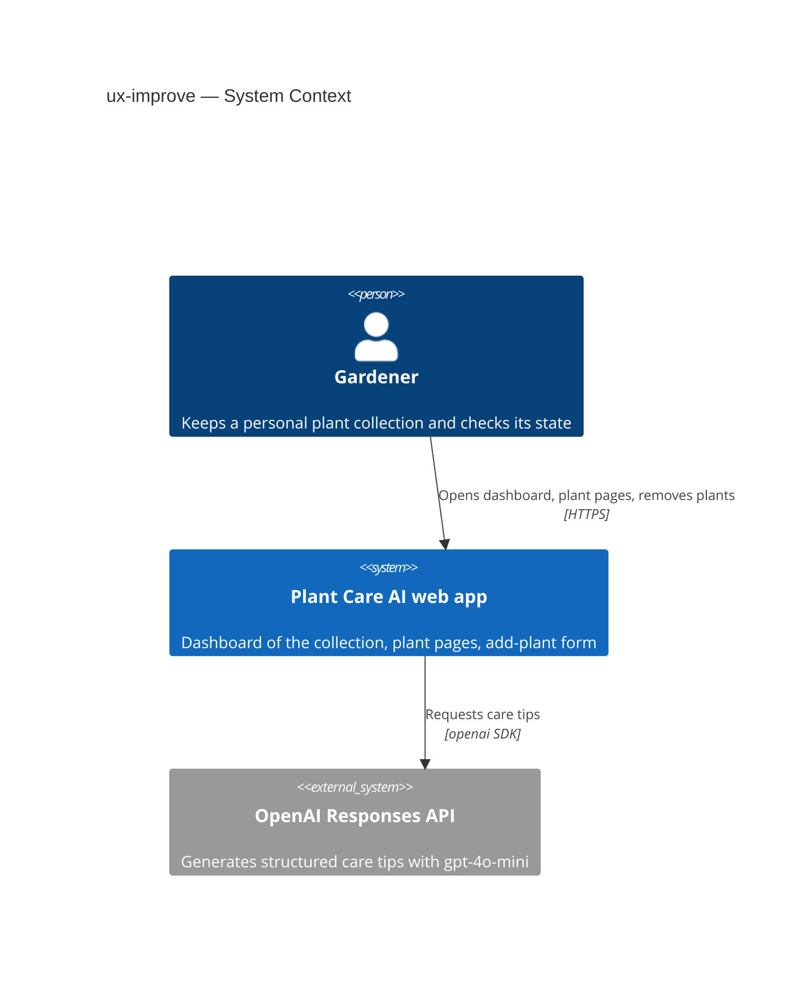
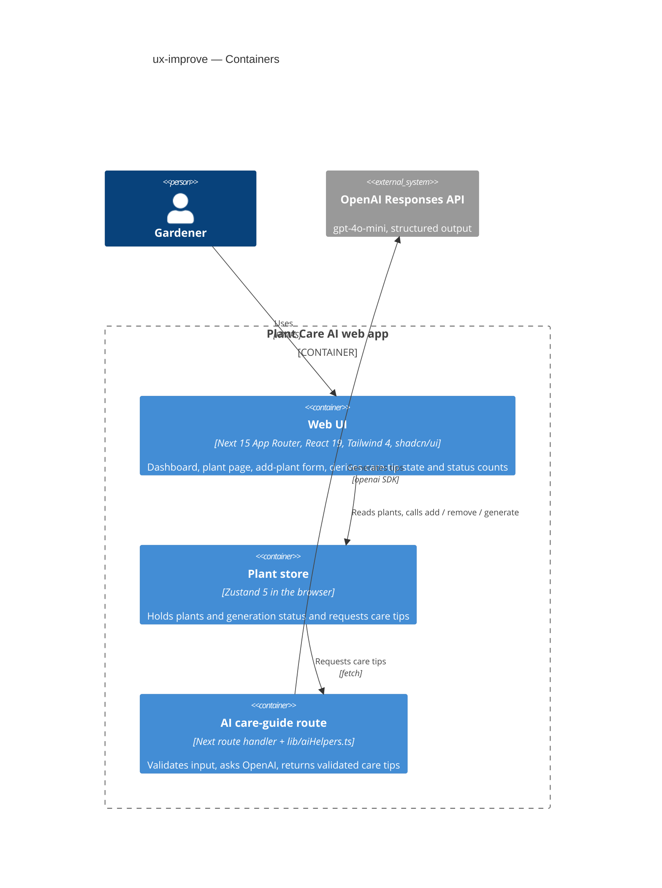
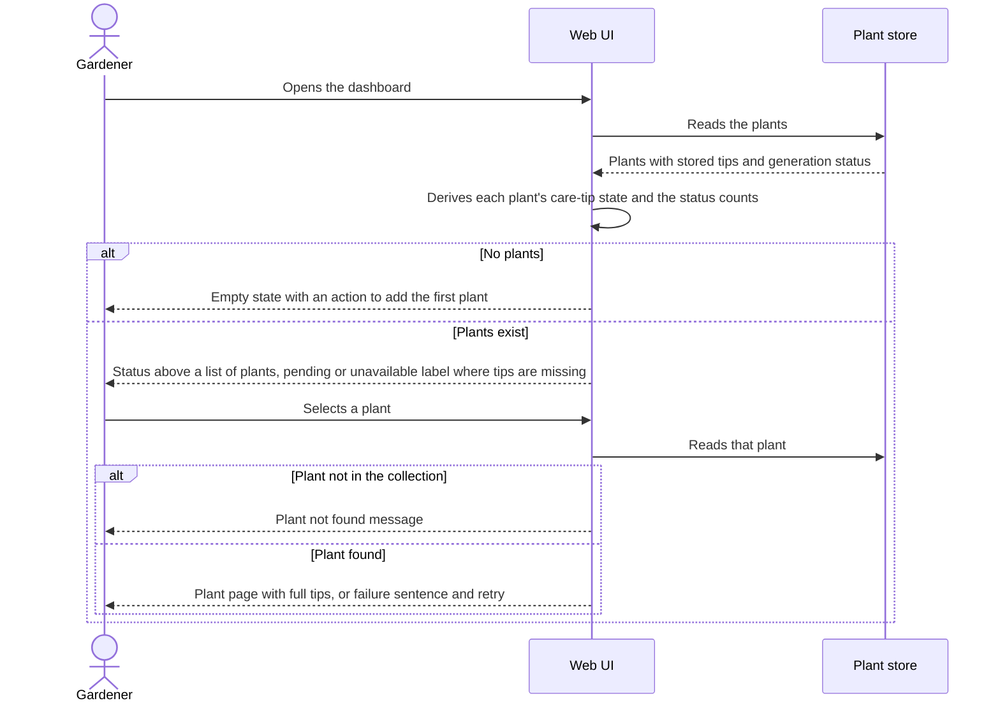
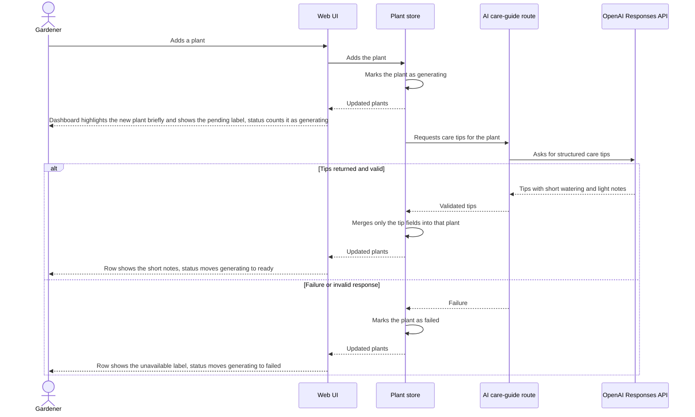
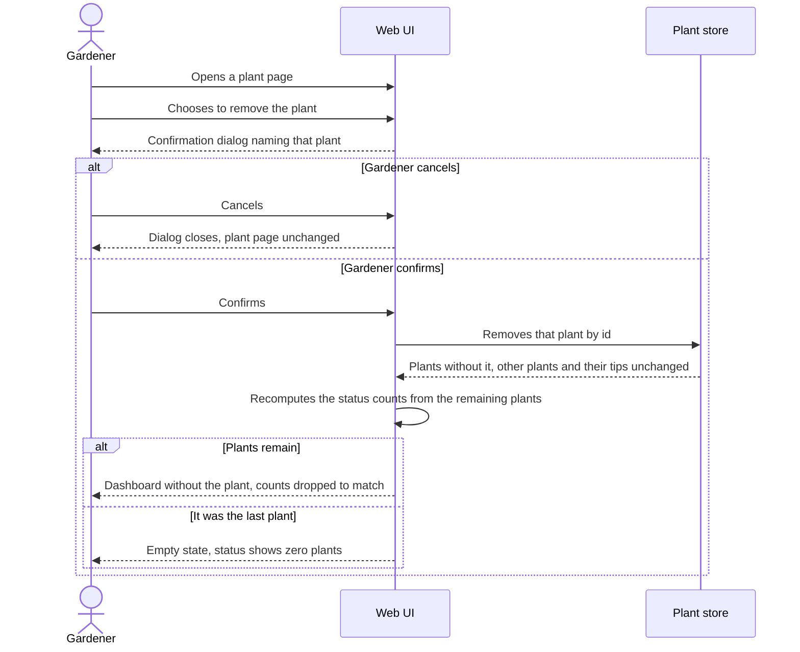
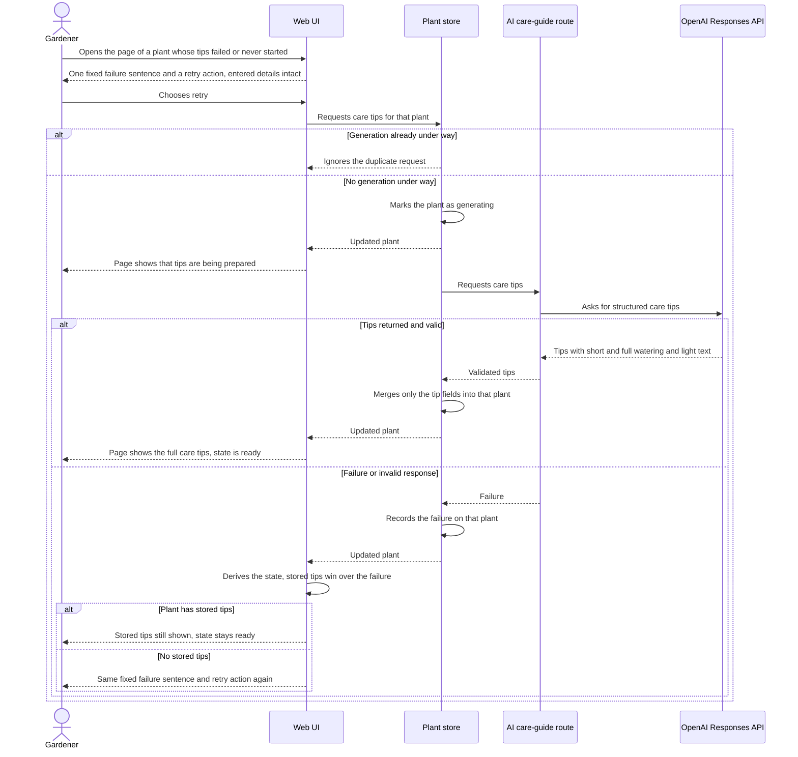

# Software Architecture Document — ux-improve

## 1. Introduction and goals

**Intent.** Turn the plant table page (`/myGarden`) into a dashboard a gardener can read in seconds: five essential columns, a collection status above the table, an empty state for a new collection, and a plant page that opens from a row and shows the full care tips. Price, size and amount move out of the table. The plant page also gains the control to remove a plant. The change lives inside the existing Next.js app; no backend, database or account work is part of it.

**Top-3 quality goals (1-liners; full scenarios in §10):**

1. A truthful picture of the collection: the status above the table always matches the plants listed, and a plant's care-tip state is decided by one rule everywhere.
2. Fast navigation: the dashboard renders and a plant opens quickly for a collection of 100 plants.
3. Usable on any device and input: readable at 360 px without sideways scrolling, fully keyboard-operable, accessible text and contrast.

**Stakeholders.**

| Role | Interest | Sign-off owner? |
|---|---|---|
| Gardener | Reads the dashboard daily, opens and removes plants | No |
| Tech Lead | SAD approval | Yes |
| Security Lead | Reviewer of record, review N/A (spec §6.1: no new authorization boundary or personal data) | No |

<!-- Decision overrides (¶4) — populated by the critic resolution loop, empty otherwise. -->

## 2. Constraints

**Technical.**
- TypeScript ^5 (strict), React ^19.0.0, Next 15.3.3 with the App Router (`package.json`, `pnpm-lock.yaml`).
- Tailwind ^4 (CSS-first) and shadcn/ui `new-york` on Radix; Zustand ^5.0.5, Zod ^3.25.56, `openai` ^6.7.0 (model `gpt-4o-mini`).
- No datastore: plants live only in the in-memory Zustand store (`lib/store/plantsStore.ts`) and reset to `lib/mockdata.ts` on refresh.
- Architecture convention: pages import the store directly; the AI call is made from the store to `POST /api/ai-care-guide`, which calls `lib/aiHelpers.ts` (AGENTS.md §4).

**Organisational.**
- Size S, one feature branch (`sdd/accounts-backend-and-ux`); no deadline or effort budget was quoted in the spec.
- One developer who owns the decisions (Orest Lyubinets).

**Conventions.**
- [AGENTS.md](../../../AGENTS.md): small client components, shadcn/ui primitives first, Zod at boundaries, no new dependencies without a reason, `pnpm typecheck` / `lint` / `test` / `build` as checks.
- IDs are `uuid` v4 generated in the store; errors are recorded as `aiStatus` / `aiError` in the store.
- **Override:** AGENTS.md §10 asks for English UI text; the owner decided on 2026-10-17 that all product UI text is Ukrainian, on every screen. This SAD follows the new requirement (ADR-0003); the document update is tracked in §11.

**Regulatory / external.**
- Data classification internal (spec §6.1); no new personal data, so no compliance controls apply.
- Plant names and AI text are rendered as plain text through React; `dangerouslySetInnerHTML` is not used (spec §6.1 abuse case).

## 3. Context and scope

A gardener keeps a personal plant collection in the browser and uses the dashboard to see what is in it and which plants have care tips ready. Care tips come from the OpenAI API through the app's own route, so the browser never holds the API key.

<!-- brownfield: docs/architecture-map.md (reflects ea5ff8f, no source changes since) — one Next 15 app with a client Zustand store and one route handler; pages `/`, `/addPlant`, `/myGarden`, `/myGarden/[id]`; no database, no auth -->

**External systems (in / out):**

| Actor or system | Type | Interaction |
|---|---|---|
| Gardener | Person | Opens the dashboard and plant pages, adds, retries tips for and removes plants |
| OpenAI Responses API | System (external) | Generates structured care tips, called only from the server route |

External: none besides OpenAI (deliberate; no accounts or backend service exist yet, they arrive with roadmap steps 1–5).

**C4 Context (L1):**



## 4. Solution strategy

**Target surface (first decision).** `web-frontend` only. The feature changes screens in the existing Next.js app; the care-tips response gains two fields inside the existing route handler and shared Zod schema, which is documented in ADR-0001 rather than as a separate API contract. Single surface, so the multi-surface gate does not fire.

**UI architecture (web-frontend).** Keep client components, Zustand as the source of truth and Tailwind/shadcn styling, as today. The dashboard is **one responsive list**, not two renderings: a table-like row on wide screens and a card on a phone, built from the same markup with Tailwind breakpoints. Each plant row is a real link to its plant page, so it is one Tab stop and Enter opens it. This reuses `components/ui/` (`table` is dropped for the list, `card`, `button`, `dialog` are reused) and follows `app/myGarden/page.tsx` as the closest precedent. No new state or routing library.

**Top strategic choices (the seeds for ADRs):**

1. **Short watering and light notes are stored with the care tips** — `CareTipsSchema` gains two short fields filled by the AI, so the dashboard shows 2–4 words and the plant page keeps the full text (ADR-0001).
2. **Care-tip state is derived, never stored** — one pure function turns stored tips plus `aiStatus` into ready / generating / failed, and the dashboard, the status counts and the plant page all call it (ADR-0002).
3. **Ukrainian UI text lives in one strings module** — every screen (landing, add-plant form, header, dashboard, plant page, removal dialog) reads its text from a single file instead of inline literals (ADR-0003).
4. **Removal moves to the plant page** — the row has exactly one focusable item (AC-10); the remove button and its confirmation dialog live on the plant page and return to the dashboard. Inline decision (reversible, one screen), no ADR; the spec and ux-flows drift it causes is recorded in §11.

Inline decisions: the collection status is computed from `plants` on each render and never stored; the highlight of a just-added plant (AC-01, `newPlantId` in the store) is kept on the new list by marking the matching row or card for about two seconds, as today; seed plants (mock data) are left as they are and show as failed (spec §8 default).

## 5. Building block view

Layered inside the existing Next app: pages compose small components; components read plants from the Zustand store; the pure derivation functions in `lib/` are the only place the care-tip state rule and the status counts exist. The store and the route keep their current responsibilities (store: plant data and generation requests; route: validate and call the helper).

**Internal decomposition (proposed; names are for `tasks` to confirm):**

```
app/myGarden/
├── page.tsx            dashboard: status + responsive list, or the empty state
└── [id]/page.tsx       plant page: full tips, failure sentence + retry, details, remove + confirm
components/             dashboard row/card, collection status, care-tip state label, empty state, remove dialog
lib/
├── careTipsState.ts    getCareTipsState(plant) and getCollectionStatus(plants)  (+ .test.ts)
└── uiStrings.ts        Ukrainian UI text for every screen (landing, add-plant form, header, dashboard, plant page, dialog)
schemas/careTipsSchema.ts   + wateringShort, sunlightShort
lib/aiHelpers.ts            prompt asks for the two short notes
types/plant.ts              TPlant gains the two optional short fields
```

`lib/plantTotals.ts` is no longer used by the dashboard (the total row is removed); `tasks` decides whether to delete it.

**C4 Container (L2):**



## 6. Runtime view

**Critical flow 1: open the dashboard and a plant**



**Critical flow 2: tips finish generating while the dashboard is open**



**Critical flow 3: remove a plant** — seeded here, covered fully by `sequences`: the gardener opens a plant page, chooses remove, confirms in a dialog; the store removes that plant only; the web UI returns to the dashboard, where the rows and the status counts no longer include it; if it was the last plant, the gardener sees the empty state with zero plants in the status (AC-08).

### Flow 3 (diagram): remove a plant



### Flow 4: retry care tips from the plant page



### Use-case and AC coverage

Participants are the §5 containers by name (the Web UI is the `<ui>`, the Plant store and the AI care-guide route are the `<service>`). No flow persists to a datastore: the collection lives in the in-memory Plant store, so there are no persist notes for `data-model`.

| §4 user story | Realised by |
|---|---|
| US-01 See the collection at a glance | Flow 1 |
| US-02 Read the collection status | Flow 1 (counts derived), Flow 2 and Flow 3 (counts update) |
| US-03 Open a plant from the dashboard | Flow 1, Flow 4 |
| US-04 Start from an empty collection | Flow 1 (empty branch), Flow 3 (last plant) |
| US-05 Use the dashboard on any device | Non-runtime, see AC-09 and AC-10 below |
| US-06 Remove a plant | Flow 3 |

| §5 AC | Shown by |
|---|---|
| AC-01 | Flow 1 (rows, state label), Flow 2 (new-plant highlight) |
| AC-02 | Flow 1 (pending or unavailable label), Flow 4 (stored tips win over a failed regeneration) |
| AC-03 | Flow 1 (status and counts derived from the plants) |
| AC-04 | Flow 2 (generating to ready or failed), Flow 3 (counts drop after removal) |
| AC-05 | Flow 1 (plant found, full tips) |
| AC-06 | Flow 4 (failure sentence, retry, generating, ready or failed again) |
| AC-07 | Flow 1 (plant not in the collection, same message); verified after roadmap step 4 |
| AC-08 | Flow 1 (empty branch), Flow 3 (last plant removed) |
| AC-09 | Non-runtime N/A: card layout, full short notes and name truncation are markup and CSS, no participant exchange |
| AC-10 | Non-runtime N/A: one Tab stop per row, Enter opens, text labels are markup and focus behaviour, no participant exchange |
| AC-11 | Flow 3 |

**Flags for `design` (not auto-applied):** none. No participant outside §5 was needed. The two non-runtime ACs (AC-09, AC-10) are verified by the manual and audit checks in §10 QG-3.

## 7. Deployment view

<!-- N/A: reuses the existing Next.js deployment unit, no infra change; the feature adds no process, service or datastore -->

The feature ships inside the same Next.js app as today. Performance targets are checked on a production build (`pnpm build`) in a browser trace.

## 8. Crosscutting concepts

| Concept | Convention | Where defined |
|---|---|---|
| Logging | Unchanged; server-side `console.error` in the AI helper only, no secrets | `lib/aiHelpers.ts` |
| Authentication / authorization | None yet. The list must show only the signed-in gardener's plants once accounts exist and treat an unknown and a foreign plant the same (AC-07, verified after roadmap step 4) | spec §6.1 |
| Error handling | The store records `aiStatus` / `aiError`; the UI shows one fixed Ukrainian sentence and never the technical error text | `lib/store/plantsStore.ts`, ADR-0002 |
| ID strategy | `uuid` v4 in the store; the dashboard keys rows by `id` (not by name) | `lib/store/plantsStore.ts` |
| Internationalisation | All product UI text in Ukrainian, read from one module on every screen; single language, no locale switching | ADR-0003 |
| Accessibility | Row is a link (one Tab stop, Enter opens); state and status are text labels, never colour alone; text contrast ≥ 4.5:1 | here, spec AC-10 |
| Untrusted text | Plant names and AI text are rendered as React text, no raw HTML | spec §6.1 |
| Persistence | None (in-memory store); the feature must work with whatever holds the collection later | AGENTS.md §8 |

## 9. Architecture decisions

| # | Title | Status | Section |
|---|---|---|---|
| 0001 | Add short watering and light fields to the care-tips schema | Accepted | §4 |
| 0002 | Derive care-tip state from stored tips and generation status | Accepted | §4 |
| 0003 | Keep Ukrainian UI text in a single strings module | Accepted | §4 |

ADR files live under `docs/features/ux-improve/adr/NNNN-<title>.md`.

## 10. Quality requirements

**QG-1. Truthful collection state**
- **When:** a plant is added or removed, or its care tips finish generating or fail.
- **Then:** the collection status shows the number of plants and how many are ready, generating and failed; the three counts add up to the number of plants and always match the plants listed (spec AC-03, AC-04).
- **How verify:** Vitest unit tests on `getCareTipsState` and `getCollectionStatus` (stored tips win over a failed regeneration; no tips and no generation counts as failed; counts sum to the total), run with `pnpm test`; a manual check that the dashboard and status agree after add, remove and retry.

**QG-2. Fast navigation**
- **When:** the collection holds 100 plants and the gardener opens the dashboard or selects a row.
- **Then:** the dashboard first render is ≤ 1 s for a collection of 100 plants, and opening a plant from a row shows the plant page in ≤ 300 ms for a collection of 100 plants.
- **How verify:** browser performance trace on a mid-range laptop against a production build with 100 seeded plants (measurement bounds still being fixed in spec §8).

**QG-3. Usable on any device and input**
- **When:** the dashboard is opened at 360 px width, or used only with the keyboard.
- **Then:** the smallest supported width is 360 px with no sideways scrolling; every plant row (or card) is one Tab stop opened with Enter; the automated accessibility audit shows no serious issues; text contrast ≥ 4.5:1.
- **How verify:** manual check in a phone-size browser view; manual Tab/Enter walk-through; automated accessibility audit (axe) run on the dashboard.

## 11. Risks and technical debt

| Risk / debt | Severity | Mitigation | Owner |
|---|---|---|---|
| Remove moved to the plant page, but spec §8 (default "control on the dashboard row") and `ux-flows.md` still place it on the row: Platform decisions, the assumptions ledger ("not offered on the plant page"), SCR-01 exit to SCR-07, and SCR-03/SCR-04 exits that only list "Back". AC-11 itself does not name a place | Medium | Update spec §8 and `ux-flows.md` (US-06 flow, screen inventory, SCR-03/04 exit to SCR-07) before `screens`; AC-10 stays literal | Orest Lyubinets |
| Removal on the plant page conflicts with AC-05 ("the rest of the current plant page left unchanged"), and the new short fields change the care-tips contract while spec §6.1 says the feature only changes how existing fields are displayed | Medium | Reword AC-05 and spec §6.1 (contract change, size stays S) before `tasks` | Orest Lyubinets |
| Product UI text is now Ukrainian on every screen, which contradicts AGENTS.md §10 and the English labels "Pending" / "Unavailable" written in spec AC-02 | Medium | Update AGENTS.md §10 and AC-02 wording (ADR-0003) before `tasks` | Orest Lyubinets |
| The short fields' length limit may not be enforceable by the structured-output feature of the installed `openai` / model; an over-long value would fail validation and mark the whole generation failed | Medium | Verify support before relying on it; otherwise enforce through the prompt plus the client-side `CareTipsSchema` check, and decide on clipping vs failing in `tasks` | Orest Lyubinets |
| Scope growth: translating the landing page, add-plant form and header (not touched by the spec) adds tasks to a size S feature | Low | Keep it to moving existing text into `lib/uiStrings.ts`; revisit the size at `tasks` if it grows | Orest Lyubinets |
| Seed (mock) plants have no tips, so the first view reads "N failed" (spec §8 default) | Low | Accepted until roadmap step 4 removes mock data | Orest Lyubinets |
| Existing defects on the touched screens: `key={plant.name}` on the dashboard, the plant page drops the last character of each care tip (AC-05 needs full tips), typo "Last watred" | Medium | Fix in this feature's tasks: key by `id`, remove the character drop, fix the typo while moving the text into the strings module; the existing Ukrainian "not found" line moves there too | Orest Lyubinets |
| No UI tests exist (Vitest runs `*.test.ts` in a node environment), so layout, keyboard and accessibility targets rely on manual and audit checks | Medium | Keep the rule logic in pure `lib/` functions with unit tests; record manual and axe results in `review` | Orest Lyubinets |
| Performance and audit measurement bounds are undefined (spec §8: build, start/end events, audit tool, failing severity) | Low | Default now: production build, click to full content visible, axe with serious and critical failing; confirm before `plan-tests` | Orest Lyubinets |

**Accepted debt (acceptable now, plan to fix later):**
- Plant data is in-memory only and resets on refresh until roadmap step 4.
- Dates remain inconsistent (`YYYY-MM-DD` from the form, `Date.toString()` in mock data); the dashboard does not show them.

## 12. Glossary

| Term | Meaning |
|---|---|
| Care tips | AI recommendations for one plant (watering, light, soil, temperature, tips); not guaranteed correct |
| Care-tip state | Ready, generating or failed, derived from stored tips and generation status; stored tips win over a failed regeneration; no tips and no generation under way counts as failed |
| Short note | The 2–4 word watering or light value stored with the care tips and shown on the dashboard (`wateringShort`, `sunlightShort`); the full text is on the plant page |
| Collection | All plants that belong to one gardener |
| Collection status | The summary above the dashboard table: number of plants and how many care tips are ready, generating or failed |
| Dashboard | The plant table page the gardener opens daily; not the welcome page |
| Plant page | The page for a single plant with all details and full care tips |
| Gardener | A person who keeps a personal plant collection; no other roles exist |
