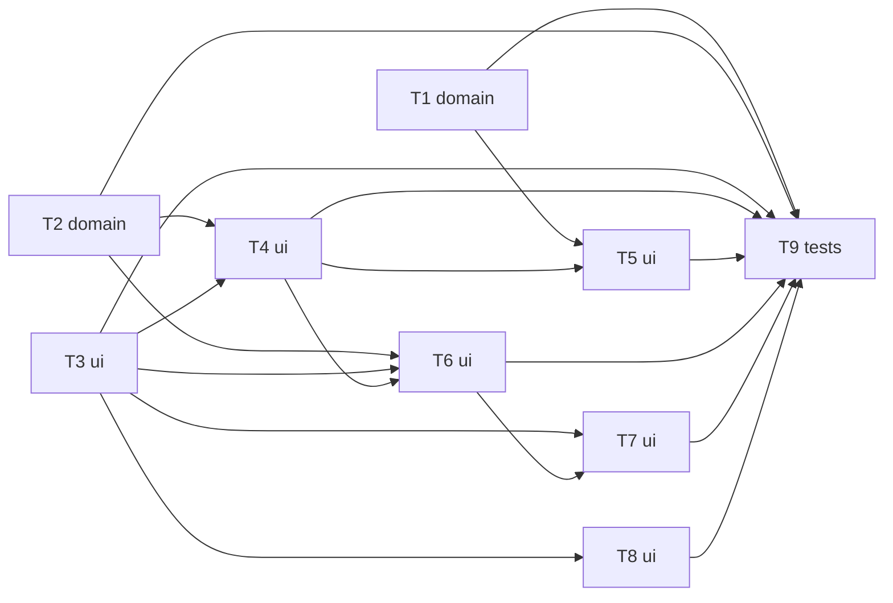

# Epic — ux-improve

> **Spec:** [spec.md](../spec.md) · **Design:** [sad.md](../sad.md) · **Screens:** [screens.md](../screens.md) · **API:** [openapi.yaml](../contracts/openapi.yaml) · **ADRs:** [adr/](../adr/)

## Goal

Turn `/myGarden` into a dashboard a gardener can read in seconds: five essential columns, a collection status, an empty state, a plant page with full tips, retry and removal, usable on a phone and by keyboard (spec §2). All product text becomes Ukrainian (ADR-0003).

## Scope

- **In:** care-tips schema short fields, derived care-tip state, dashboard, plant page, removal dialog, Ukrainian strings module, checks.
- **Out:** onboarding, reminders, accounts/server persistence, search/filter/sort/photo (spec §3). No `data-model.md`: there is no database.

## Task map

## Tasks

See [tracker.md](./tracker.md) for status. Machine contract: [tasks.json](../tasks.json).

| # | Task | Layer | Blocked by | DoD (short) |
|---|---|---|---|---|
| T1 | [Add short watering and light notes to the care-tips schema, type and prompt](./short-notes-in-care-tips.md) | domain | — | Schema, type, prompt and tests include both short fields; `pnpm test` passes without calling real OpenAI |
| T2 | [Add getCareTipsState and getCollectionStatus pure functions with unit tests](./care-tips-state-functions.md) | domain | — | Unit tests cover all five cases above and `ready + generating + failed === total` for any input |
| T3 | [Create lib/uiStrings.ts with the Ukrainian text of the dashboard, plant page and removal dialog](./ui-strings-module.md) | ui | — | `lib/uiStrings.ts` exports every string listed in `screens.md` for SCR-01…SCR-05 and SCR-07 |
| T4 | [Build CareTipStateLabel, CollectionStatus, EmptyState and PlantListItem components](./dashboard-components.md) | ui | T2, T3 | The four components render the states in `screens.md` SCR-01/SCR-02; no nested interactive elements inside the row link |
| T5 | [Rebuild /myGarden as the dashboard: status, responsive list, empty state, highlight](./dashboard-page.md) | ui | T1, T4 | Dashboard shows only name, type, location, watering, light; status counts match the rows after add/retry |
| T6 | [Update the plant page: back link, state label, fixed failure sentence with retry, full tips, not-found](./plant-page-states.md) | ui | T2, T3, T4 | SCR-03 ready/generating, SCR-04 failed, SCR-05 not-found render as in `screens.md` |
| T7 | [Add RemovePlantDialog on the plant page and navigate back to the dashboard after removal](./remove-plant-dialog.md) | ui | T3, T6 | Removing a plant updates rows and status counts together (manual check, plus store test if one is missing for `removePlant`) |
| T8 | [Move the text of the landing page, add-plant form and header into uiStrings in Ukrainian](./translate-existing-screens.md) | ui | T3 | No English product text remains on the landing page, header or add-plant form (grep and visual check) |
| T9 | [Run all checks, audit accessibility and performance, and update AGENTS.md and spec wording](./verify-and-update-docs.md) | tests | T1, T2, T3, T4, T5, T6, T7, T8 | `pnpm typecheck`, `pnpm lint`, `pnpm test`, `pnpm build` all pass, output recorded |

## Risks / Hard rules

- Plant names and AI text render as plain text; no `dangerouslySetInnerHTML` (spec §6.1).
- One rule for care-tip state (`getCareTipsState`); never store a derived state (ADR-0002).
- All UI text comes from `lib/uiStrings.ts` (ADR-0003).
- No UI tests exist; layout, keyboard and axe checks are manual and recorded in T9 and `review`.
- AC-07 (foreign plant) is verified only after roadmap step 4.
- Doc drift (spec §8 remove placement, AC-02 labels, AC-05, §6.1, `ux-flows.md`) is resolved in T9.
