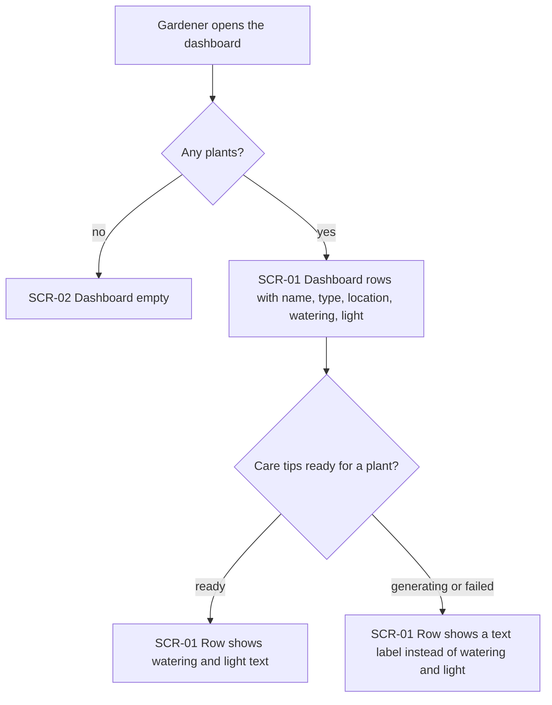
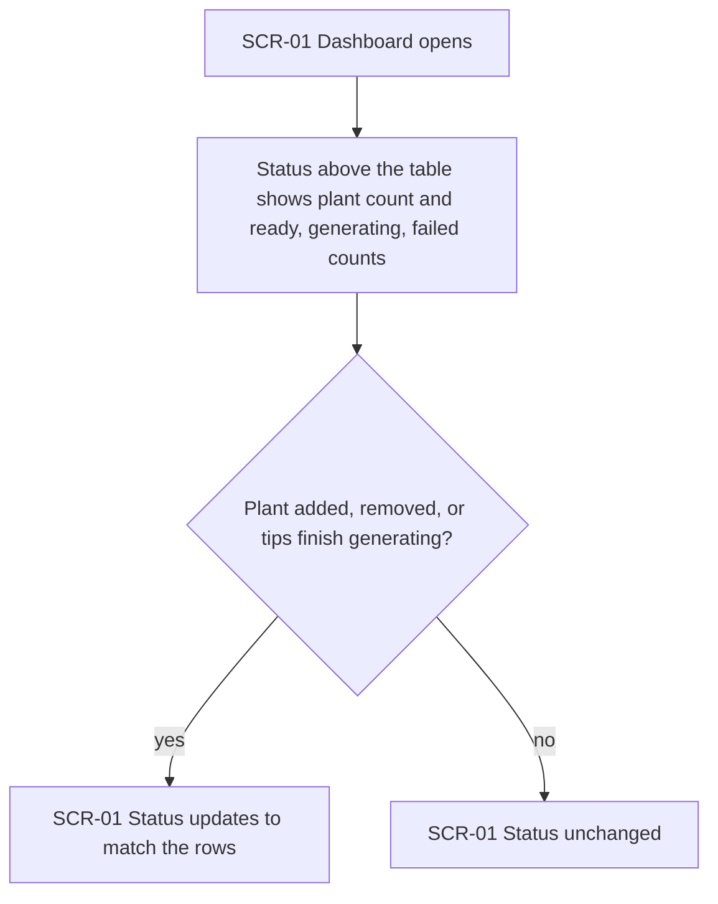
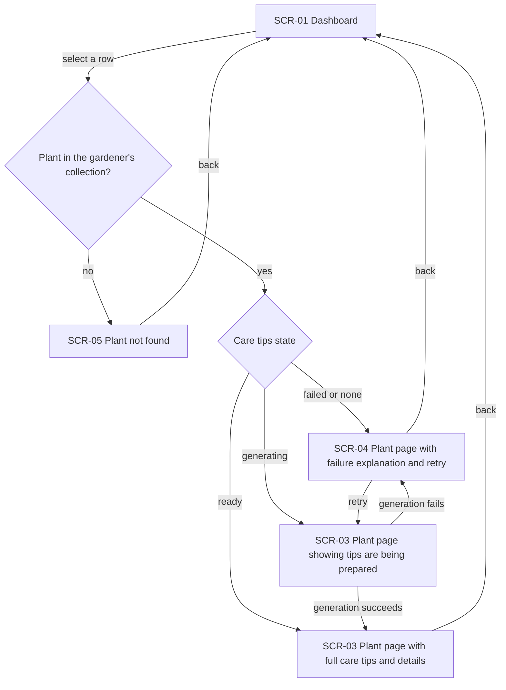
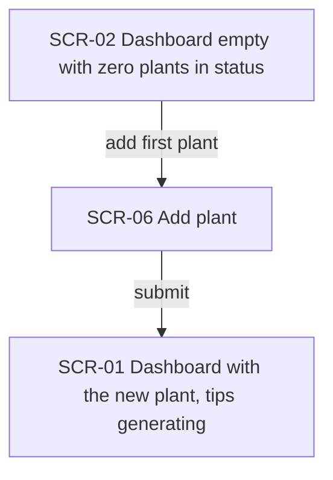
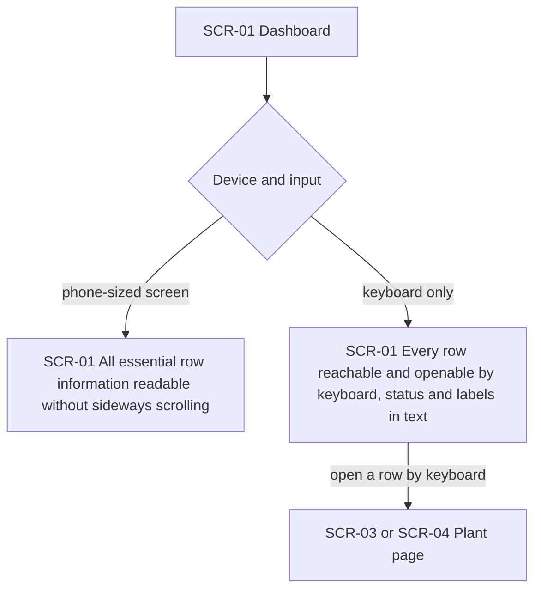

# UX flows — ux-improve

> User flows for every UI-touching §4 user story, produced by `ux-flows` and read by `design`, `sequences`, `screens` and `plan-tests`. Always markdown + mermaid `flowchart`; flow altitude only, not visual design.

## Platform decisions

- **Posture:** responsive-both — `docs/design-system.md` is absent, so assumed from US-05 (phone and desktop); the desktop layout is the reference and the phone layout must not need sideways scrolling.
- The dashboard is a page, not a dialog. Opening a plant is a navigation to the plant page, and returning goes back to the dashboard.
- The care-tip state is a text label next to the plant name in each row (AC-01, AC-10).

## Screen inventory

| ID | Screen | Purpose | Entry | Exit |
|---|---|---|---|---|
| SCR-01 | Dashboard (with plants) | Collection status above a table of plants: name, type, location, watering, light | Opening the dashboard; returning from a plant page or from adding a plant | Row → SCR-03 or SCR-04; add action → SCR-06 |
| SCR-02 | Dashboard (empty) | Empty-state message, status showing zero plants, action to add the first plant | Opening the dashboard with no plants | Add action → SCR-06 |
| SCR-03 | Plant page (tips ready) | Full care tips and all details, including price, size and amount | Row selected on SCR-01 | Back → SCR-01 |
| SCR-04 | Plant page (tips failed) | Plain-language failure explanation and a retry action, entered details intact | Row selected on SCR-01 for a failed plant | Retry → generating, then SCR-03; back → SCR-01 |
| SCR-05 | Plant not found | Same message for an unknown plant and for another gardener's plant | Opening a plant that is not in the gardener's collection | Back → SCR-01 or SCR-02 |
| SCR-06 | Add plant | Existing add-plant form, unchanged by this feature | Add action from SCR-01 or SCR-02 | Submit → SCR-01 |

## Flows

### Flow: US-01 — See the collection at a glance

When the gardener opens the dashboard with at least one plant, each plant is one row with name, type, location, watering and light, and its care-tip state as a text label next to the name. Price, size and amount are not shown. If a plant's tips are ready the watering and light cells hold the text. If they are still generating or have failed (including a plant with no tips and no generation under way), the plant stays listed and those cells show a label instead of being blank. With no plants the gardener sees the empty dashboard instead.

### Flow: US-02 — Read the collection status

Above the table the gardener sees how many plants the collection holds and how many have tips ready, generating or failed; the three counts add up to the plant count. When a plant is added or removed, or generation finishes, the status changes with the rows so the two never disagree.

### Flow: US-03 — Open a plant from the dashboard

Selecting a row opens that plant's page. A ready plant shows the full care tips and all details, including price, size and amount. A failed plant, or one with no tips and no generation under way, shows a plain explanation and a retry action while keeping its entered details; retrying moves it to generating and then to ready or back to failed. A generating plant shows that tips are being prepared. A plant that is not in the gardener's collection leads to the same not-found message as one that does not exist. Back returns to the dashboard.

### Flow: US-04 — Start from an empty collection

A gardener with no plants sees an empty-state message and status showing zero plants, and no empty table. The prominent add action opens the add-plant form; after submitting, the dashboard shows the new plant with its tips generating.

### Flow: US-05 — Use the dashboard on any device

On a phone-sized screen every row's essential information is readable without sideways scrolling. With only a keyboard the gardener can move to every row and open it, and the collection status and care-tip labels are conveyed in text, not by colour alone.

## AC coverage

| AC | Shown by | Notes |
|---|---|---|
| AC-01 | Flow US-01 → SCR-01 rows | Care-tip state label next to the name |
| AC-02 | Flow US-01 → generating or failed branch | Label replaces blank watering and light cells |
| AC-03 | Flow US-02 → status node | Counts add up to the plant count |
| AC-04 | Flow US-02 → update branch | Status always matches the rows |
| AC-05 | Flow US-03 → ready branch → SCR-03 | |
| AC-06 | Flow US-03 → failed or none branch → SCR-04 | Includes retry and the generating loop |
| AC-07 | Flow US-03 → not-in-collection branch → SCR-05 | Verified after roadmap step 4 |
| AC-08 | Flow US-04 → SCR-02 | |
| AC-09 | Flow US-05 → phone branch | |
| AC-10 | Flow US-05 → keyboard branch | |
