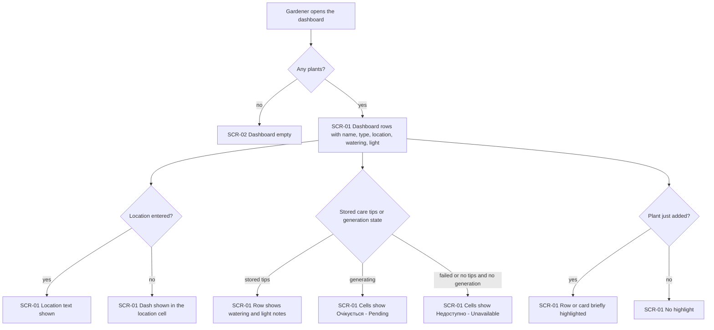
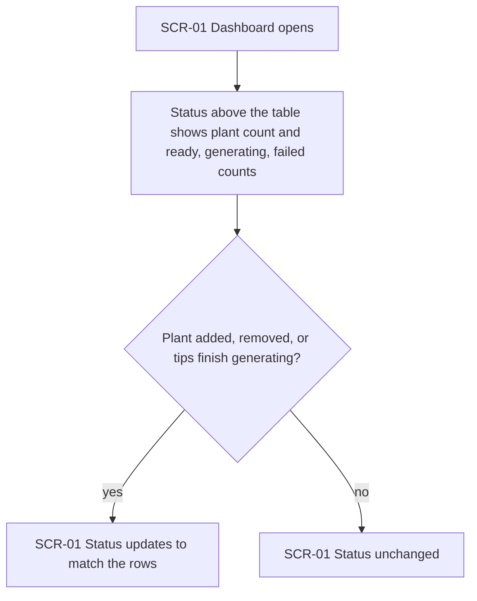
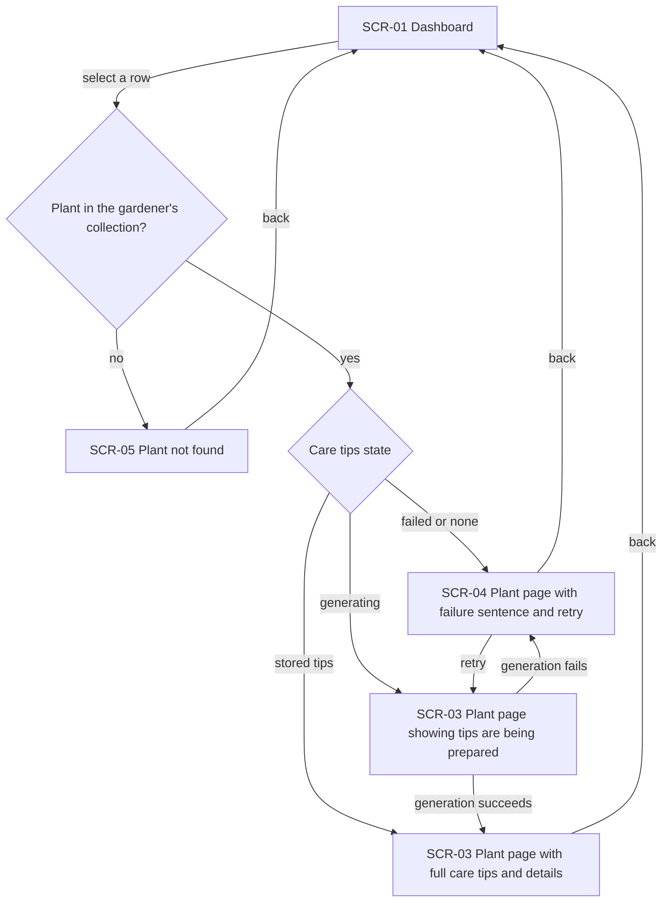
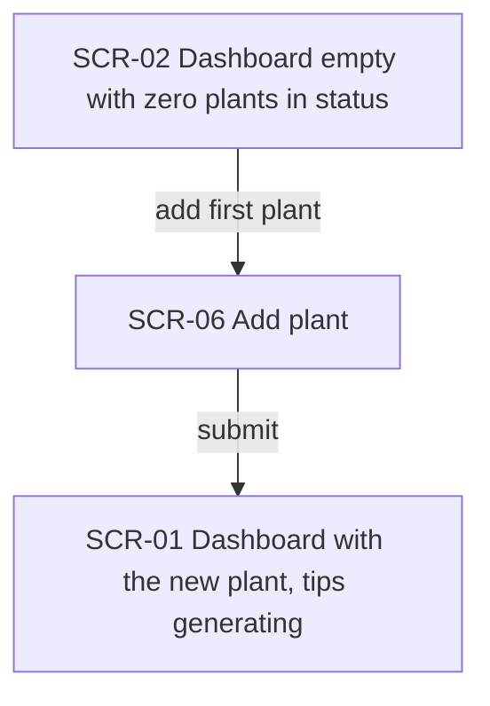
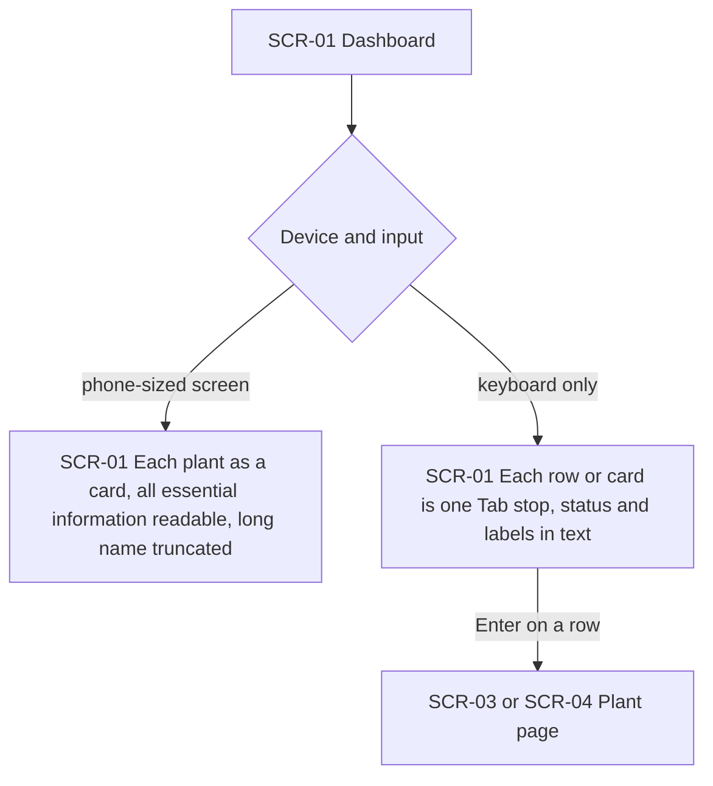
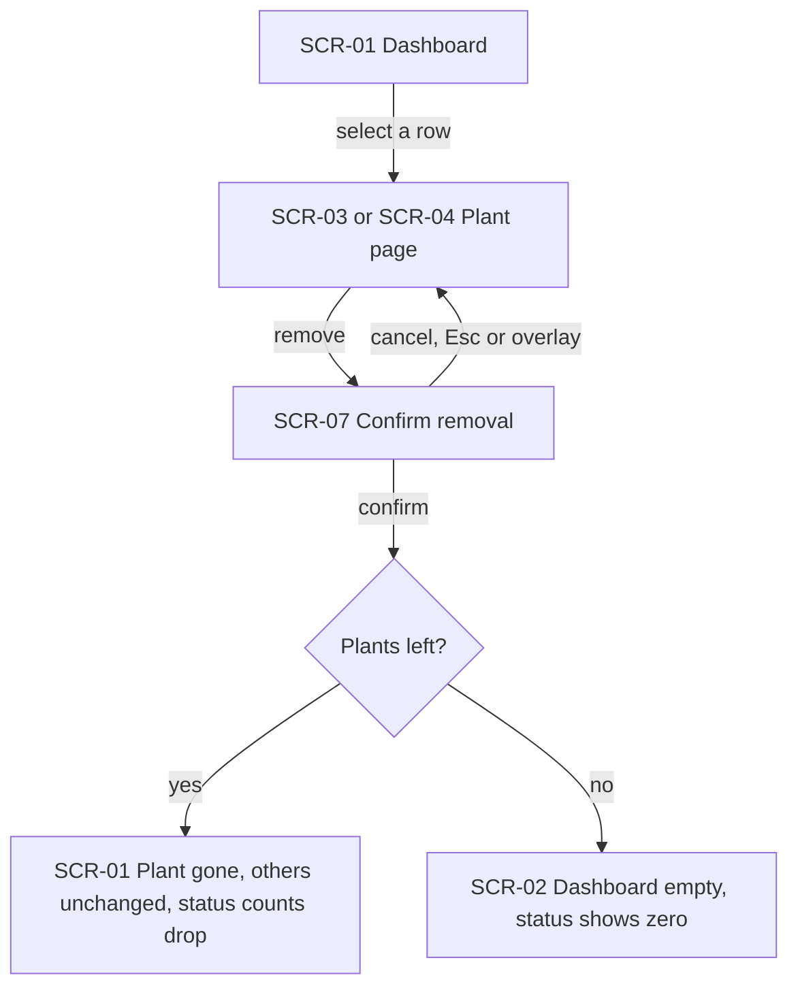

# UX flows — ux-improve

> User flows for every UI-touching §4 user story, produced by `ux-flows` and read by `design`, `sequences`, `screens` and `plan-tests`. Always markdown + mermaid `flowchart`; flow altitude only, not visual design.

## Platform decisions

- **Posture:** responsive-both — taken from `docs/design-system.md` (`platform_posture: responsive-both`), consistent with US-05 (phone and desktop); the desktop layout is the reference and the phone layout must not need sideways scrolling. On a phone-sized screen each plant may be a card instead of a table row (AC-09).
- The dashboard is a page, not a dialog. Opening a plant is a navigation to the plant page, and returning goes back to the dashboard.
- The care-tip state is a text label next to the plant name in each row or card (AC-01, AC-10).
- Each plant row (or card) is one focusable item opened with Enter (AC-10).
- Removing a plant starts from the plant page (SCR-03/SCR-04) and asks for confirmation (SCR-07); decided in sad.md §4.

## Screen inventory

| ID | Screen | Purpose | Entry | Exit |
|---|---|---|---|---|
| SCR-01 | Dashboard (with plants) | Collection status above a table of plants (cards on a phone): name, type, location, watering, light | Opening the dashboard; returning from a plant page, from adding a plant, or after removing a plant | Row → SCR-03, SCR-04 or SCR-05; add action → SCR-06 |
| SCR-02 | Dashboard (empty) | Empty-state message, status showing zero plants, action to add the first plant | Opening the dashboard with no plants; removing the last plant | Add action → SCR-06 |
| SCR-03 | Plant page (tips ready or generating) | Full care tips and all details, including price, size and amount; shows that tips are being prepared while generating | Row selected on SCR-01 for a ready or generating plant | Back → SCR-01; remove action → SCR-07 |
| SCR-04 | Plant page (tips failed) | One plain-language failure sentence and a retry action, entered details intact | Row selected on SCR-01 for a failed plant or one with no tips and no generation under way | Retry → generating (SCR-03), then ready (SCR-03) or failed (SCR-04); back → SCR-01; remove action → SCR-07 |
| SCR-05 | Plant not found | Same message for an unknown plant and for another gardener's plant | Opening a plant that is not in the gardener's collection | Back → SCR-01 or SCR-02 |
| SCR-06 | Add plant | Existing add-plant form, unchanged by this feature | Add action from SCR-01 or SCR-02 | Submit → SCR-01 |
| SCR-07 | Confirm removal | Asks the gardener to confirm removing one named plant | Remove action on SCR-03 or SCR-04 | Confirm → SCR-01 (or SCR-02 if it was the last plant); cancel → back to the plant page, unchanged |

## Flows

### Flow: US-01 — See the collection at a glance

When the gardener opens the dashboard with at least one plant, each plant is one row (a card on a phone) with name, type, location, watering and light, and its care-tip state as a text label next to the name. Price, size and amount are not shown. A plant that has stored care tips is ready and shows its watering and light notes, even if its latest regeneration failed. A plant whose tips are generating shows «Очікується» ("Pending") in both cells; a failed plant, or one with no tips and no generation under way, shows «Недоступно» ("Unavailable"), and it stays listed. A plant with no location shows a dash. A plant that was just added is briefly highlighted. The dashboard offers no retry. With no plants the gardener sees the empty dashboard instead.

### Flow: US-02 — Read the collection status

Above the table the gardener sees how many plants the collection holds and how many have tips ready, generating or failed; the three counts add up to the plant count. When a plant is added or removed, or generation finishes, the status changes with the rows so the two never disagree.

### Flow: US-03 — Open a plant from the dashboard

Selecting a row opens that plant's page. A plant with stored tips shows the full care tips and all details, including price, size and amount; the current layout is kept, with a back link, the care-tip state label and the remove control added. A failed plant, or one with no tips and no generation under way, shows the same one plain-language sentence (no technical error detail) and a retry action while keeping its entered details; retrying moves it to generating and then to ready or back to failed. A generating plant shows that tips are being prepared. A plant that is not in the gardener's collection leads to the same not-found message as one that does not exist. Back returns to the dashboard.

### Flow: US-04 — Start from an empty collection

A gardener with no plants sees an empty-state message and status showing zero plants, and no empty table. The prominent add action opens the add-plant form; after submitting, the dashboard shows the new plant with its tips generating.

### Flow: US-05 — Use the dashboard on any device

On a phone-sized screen every plant's essential information is readable without sideways scrolling; plants may appear as cards, the watering and light notes are shown in full, and a name that is too long is truncated (the full name is on the plant page). With only a keyboard the gardener tabs to each row or card, which is one focusable item, and opens it with Enter; the collection status and care-tip labels are conveyed in text, not by colour alone.

### Flow: US-06 — Remove a plant

The gardener opens a plant from the dashboard, picks remove on its page and is asked to confirm in a dialog that names the plant. Cancelling leaves the plant page and the collection as they were. Confirming removes that plant only: the other plants and their care tips are unchanged and the status counts drop to match. The gardener returns to the dashboard; if it was the last plant, they see the empty dashboard. The remove control sits on the plant page so each dashboard row stays one focusable item (sad.md §4, spec §8).

## AC coverage

| AC | Shown by | Notes |
|---|---|---|
| AC-01 | Flow US-01 → SCR-01 rows; highlight branch | Care-tip state label next to the name; new-plant highlight kept |
| AC-02 | Flow US-01 → Pending, Unavailable, stored-tips and dash branches | Labels replace blank cells; stored tips win over a failed regeneration |
| AC-03 | Flow US-02 → status node | Counts add up to the plant count |
| AC-04 | Flow US-02 → update branch; Flow US-06 → confirm branch | Status always matches the rows |
| AC-05 | Flow US-03 → stored-tips branch → SCR-03 | |
| AC-06 | Flow US-03 → failed or none branch → SCR-04 | Includes retry and the generating loop |
| AC-07 | Flow US-03 → not-in-collection branch → SCR-05 | Verified once per-user collections exist |
| AC-08 | Flow US-04 → SCR-02 | |
| AC-09 | Flow US-05 → phone branch | Cards allowed, truncation of long names |
| AC-10 | Flow US-05 → keyboard branch | One Tab stop per row or card, Enter opens |
| AC-11 | Flow US-06 → confirm branch → SCR-01 or SCR-02 | Remove from the plant page with a confirmation dialog (spec §8, decided) |

## Assumptions ledger

- Decided: the remove control is on the plant page (SCR-03, SCR-04) with a confirmation dialog (SCR-07), not on the dashboard row = sad.md §4, spec §8.
- Assumed: a generating plant opens SCR-03 (shows tips being prepared) rather than a separate screen = keeps the inventory small. [veto?]
