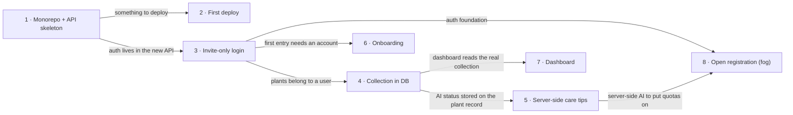

# Roadmap — planted-ai

> **A decomposition, not a promise.** The overall idea broken into incremental steps: what each
> step is, where it comes from, how big it is — or that nobody has looked at it yet — and in which
> order, and parallel lanes, we walk them. **No dates** (except shipped history), **no scores** —
> order is the prioritization. The *solution* for any step lives in its `docs/features/<slug>/`
> spec, not here.

## Destination

An invited user can register, keep a personal plant knowledge base with AI-generated care tips, and open the same collection from any device, served by a separate Node.js API with its own database.

## Steps

| # | Step | Source | Size | Status |
|---|---|---|:---:|---|
| 1 | Monorepo with a running API skeleton: the Next app moves to `apps/web`, `apps/api` and Postgres run in Docker Compose, `/api` is proxied through Next | idea-brief.md §5 Out of scope | M | idea |
| 2 | First deploy: web, API and database run on a PaaS | idea-brief.md §4 Why now | S | idea |
| 3 | Invite-only sign-up and login with email and password, protected pages, logout | idea-brief.md §7 Recommendation | M | idea |
| 4 | Personal collection in the database: each user sees only their own plants, starts empty, mock data removed | idea-brief.md §2 Problem | M | idea |
| 5 | Care tips generated on the server and visible on any device, old `/api/ai-care-guide` route removed | idea-brief.md §6 Risks | M | idea |
| 6 | Short onboarding shown only on first entry | idea-brief.md §2 Problem | S | idea |
| 7 | Collection dashboard: essential columns, collection status, a click opens the plant page with care tips | idea-brief.md §2 Problem | S | idea |
| 8 | Open registration with abuse controls → see [Not yet specified](#not-yet-specified) | idea-brief.md §8 Open questions | fog | idea |

## Not yet specified

| Area | What we'd have to learn | Blocks | How it gets sharpened |
|---|---|:---:|---|
| Open registration and abuse controls | Which controls are needed before strangers can sign up (email verification, password reset, rate limits, per-user AI quotas, a monthly OpenAI spend cap) and how much of each is in the first public release | 8 | A recon pass after steps 3 and 5 exist, with the real auth and AI paths in hand |

## Out of scope

- Care tracking, computed "required actions" and a watering log — watering cannot be reliably computed (idea-brief.md §5 Out of scope).
- Reminders, notifications, season and weather tracking — future functionality (idea-brief.md §5 Out of scope).
- BaaS such as Supabase for auth and data — auth and access checks are hand-written for learning value (idea-brief.md §5 Out of scope).
- Kubernetes and complex infrastructure (idea-brief.md §5 Out of scope).

## Open decisions

| # | Question | Type | Owner | Blocks |
|---|---|:---:|:---:|:---:|
| D1 | Sessions or JWT, password hashing, and how an invite is issued and redeemed | grilling | human | 3 |
| D2 | Which PaaS and Postgres host (research found Vercel + Render + Neon as the fewest-ops free combination, with the Render free API sleeping after 15 minutes idle) | grilling | human | 2 |
| D3 | Where AI generation runs on the server and which `AGENTS.md` rule changes (§4.2, §9 or §13), recorded as an ADR | grilling | human | 5 |
| D4 | Database types and constraints for `price`, `size` and `amount`, currently free strings | grilling | human | 4 |
| D5 | Where the "onboarding completed" flag lives: on the account or in the browser | grilling | human | 6 |
| D6 | The final dashboard columns beyond name, type and location | grilling | human | 7 |

## Decisions so far

- MVP is a personal plant knowledge base, care tracking is out → [`idea-brief.md` §7](idea-brief.md)
- Separate Node.js/TS API (leaning NestJS), PostgreSQL, pnpm monorepo, hand-written auth, Docker Compose, PaaS on free tiers → [`idea-brief.md` §5](idea-brief.md)
- Week 8 means deployed with invite-only access, open registration comes after → [`idea-brief.md` §4](idea-brief.md)
- Email and password login → [`idea-brief.md` §7](idea-brief.md)
- Finished care tips are visible on any device even if the creating tab was closed → [`idea-brief.md` §7](idea-brief.md)
- The existing Next route handler would shadow a plain-array `/api` rewrite, so it must be removed or moved behind the backend → [`architecture-map.md` Constraints](architecture-map.md)

## Dependency graph

## Execution path

Zones below are first-cut paths in the current layout. After step 1 the existing web paths move under `apps/web/`.

| Wave | Steps | Zone per step (why parallel-safe) | Unlocks |
|:---:|---|---|---|
| 1 | 1 | `package.json` and the whole web tree move under `apps/web` · `apps/api` (new) · `packages/shared` (new) — runs alone because it touches every path | 2, 3 |
| 2 | 2 ∥ 3 | 2: deploy and container config (new) · 3: `apps/api` auth module (new) and login pages (new) — disjoint | 4, 6, 8 |
| 3 | 4 ∥ 6 | 4: `apps/api` plants module and migrations (new), `lib/store/plantsStore.ts`, `app/addPlant/page.tsx`, `lib/mockdata.ts` · 6: `app/page.tsx` and onboarding components (new) — disjoint | 5, 7 |
| 4 | 5 ∥ 7 | 5: `apps/api` AI module (new), `lib/aiHelpers.ts`, `app/api/ai-care-guide/route.ts` · 7: `app/myGarden/page.tsx` — disjoint | 8 |

## Shipped

| Step | Shipped | Link |
|---|---|---|
